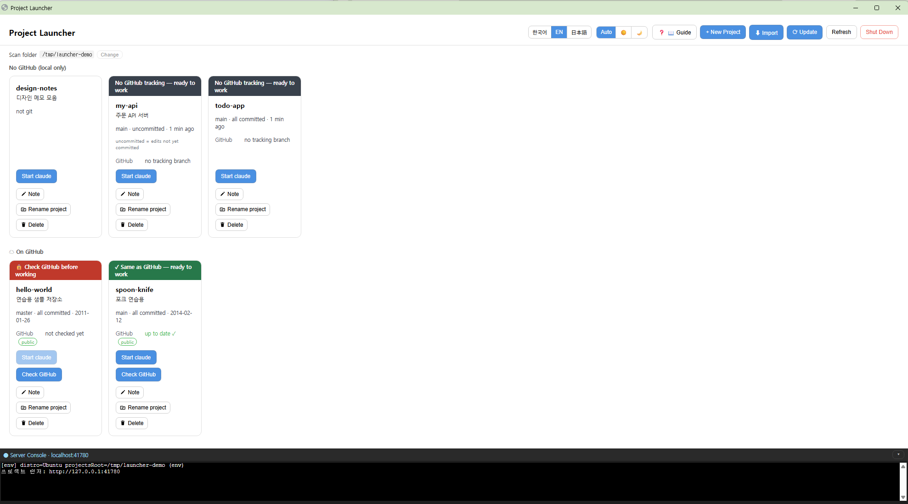

# Claude WSL Launcher

[한국어](README.md) · **English** · [日本語](README.ja.md)

A small tool that **shows your project folders as cards and launches Claude Code in the right folder with one click.**
Instead of opening a terminal and typing `cd something && claude` every time, you double-click a desktop shortcut.



> **Windows 10/11 only.** (It does not work on macOS or plain Linux.)

---

## Why would I want this?

Claude Code only works properly — and quickly — when it is launched from a **WSL folder** (the Linux side of Windows). If you open a folder through Windows Explorer and launch from there, you get "Do you trust this folder?" over and over, and file operations run **5–10× slower.**

This tool always launches claude **the right way**, so you don't have to know any of that. If you have several projects, you see them all as cards, and you can pick up yesterday's conversation where you left off.

---

## Installing

### First: which one are you?

| Your situation | Go to |
|---|---|
| Nothing set up yet / I don't know what WSL is | **A. Starting from scratch** below |
| I already use Claude Code in WSL | **B. Two lines** below |

> **💡 Heads up — the web or desktop Claude app cannot install this for you.**
> Claude on claude.ai (web) and the Windows desktop app **cannot install programs on your computer.** They can tell you how, but they cannot do it for you.
> The one that *can* do it for you is **Claude Code (the CLI)**, which runs in a terminal. Step 2 of A installs that first.

---

### A. Starting from scratch (a blank Windows PC)

You only do steps **1 and 2 plus one login** yourself. From step 3 on, you can hand it to Claude Code.

| | Where | What to do |
|---|---|---|
| **1** | **Windows PowerShell (as Administrator)** | Run `wsl --install` → **restart your PC** → when the Ubuntu window appears, create a **username and password** |
| **2** | **Ubuntu terminal** | `curl -fsSL https://claude.ai/install.sh \| bash` → then run `claude` and **sign in** |
| **3** | Ubuntu terminal | `cd ~ && git clone https://github.com/GojoSuperman/claude-wsl-launcher.git && cd claude-wsl-launcher && claude` |
| **4** | **Inside Claude Code** | Type **"install this"** — it takes care of the rest |
| **5** | Desktop | **Double-click** the shortcut it created |

> **Write down the password from step 1.** You will be asked for it later when installing software (`sudo`). If you forget it, you can set a new one — see [troubleshooting](#when-you-get-stuck).

**What is the "Ubuntu terminal"?** Search for **"Ubuntu"** in the Start menu and click it — that **black window** is it. It is not the blue PowerShell window. If the prompt looks like `name@computer:~$`, you're in the right place.

---

### B. Two lines (if you already have WSL and Claude Code)

In the Ubuntu terminal:

```bash
cd ~ && git clone https://github.com/GojoSuperman/claude-wsl-launcher.git && cd claude-wsl-launcher
bash scripts/setup.sh
```

`setup.sh` finds what's missing (Node, etc.), offers to install it, creates the work folder (`~/projects`), and creates the desktop shortcut. When it finishes, **double-click the shortcut**.

- Projects live in the **work folder `~/projects`** inside WSL (fixed). Bring projects from elsewhere with `⬇ Import` in the dashboard.
- Keep the tool itself in your home (`~`), **not inside** `~/projects`.
- Want to check each step yourself? → **[Setup Guide](docs/SETUP.en.md)**

---

### Don't panic during installation

These are the moments where first-timers stop and think something broke. **All of them are normal.**

| If you see this | It actually means |
|---|---|
| You type your password and **nothing appears** | Normal. Linux never shows the password as you type. Just type it and press Enter. |
| `Command 'xxx' not found, but can be installed with:` | Not an error — it's **telling you how to install it**. Run the command it suggests. |
| `Do you want to continue? [Y/n]` | Type `Y` and press Enter. |
| Text scrolling by | It's installing. Wait until it stops. |
| It takes several minutes | Normal. It's downloading. |

---

## Using it

Double-click the desktop shortcut and the dashboard opens in your browser. One folder = one card.

| Button | What it does |
|---|---|
| **Launch claude** | Starts claude in a new window for that folder, **continuing** your previous conversation if there is one. |
| **Check GitHub → Pull** | Checks whether GitHub has newer changes and brings them to your PC. |
| **⬇ Import** | Bring a project into the work folder from three tabs: **GitHub** (clone your repo) / **💻 My PC** (copy a Windows folder such as Desktop or Documents — the original stays) / **🐧 WSL** (move another folder from your home). |
| **+ New project** | Creates a new folder. |
| **Note** | A one-line note per card, for when you can't tell projects apart. |
| **Rename / Delete** | Renames or removes the folder, optionally handling the GitHub repository too. |
| **🗑 Trash** | Restore deleted projects or delete them forever (next to the work folder; shown only when something was deleted). |
| **✨ What's new** | Introduces what changed in an update. It opens automatically the first time after an update. |
| **⟳ Update** | Updates this tool itself. |
| **Shut down** | Stops it. Closing the window also stops it after about 10 seconds. |

**What the colour strip means**: 🔴 red = needs a check/pull · 🟢 green = same as GitHub (safe to work) · 🟡 yellow = your changes aren't on GitHub yet

Press the `📖 Guide` button (or the `?` key) inside the app to see the same explanations any time.

### To use the GitHub features (optional)

`⬇ Import` and repository deletion need a **GitHub CLI login**, once. **Everything else works fine without it.**

In the Ubuntu terminal:

```bash
sudo apt install gh     # if it says gh is not found, do this first
gh auth login           # then sign in
```

`gh auth login` asks a few questions. Use the arrow keys and Enter: **GitHub.com** → **HTTPS** → **Yes** → **Login with a web browser**. It then shows an 8-character code; press Enter, paste that code into the browser that opens, and click **Authorize**.

---

## Updating

Just press **`⟳ Update` in the header.** It checks, downloads, and walks you through shutting the server down so the update takes effect. Then launch the desktop shortcut again. **No terminal needed.**

You never need to clone again either. Your settings and notes live outside the repository, and the desktop shortcut keeps working.

<details>
<summary>If the button isn't there or fails — updating from the terminal</summary>

The button exists in versions from September 2026 onward. On an older version, update **once** with the commands below and you can use the button from then on.

```bash
cd ~/claude-wsl-launcher
git pull
npm install
```

Then **restart the dashboard.**

> ⚠️ If you `git pull` while it is running, the buttons on screen update but **the running server is still the old code**, so new features fail with a "server error". Nothing is broken. Click **[Shut down server]** in the header and launch the shortcut again.

</details>

---

## When you get stuck

This usually finds the cause and prints the command to fix it:

```bash
bash scripts/doctor.sh        # diagnose only
bash scripts/doctor.sh --fix  # ask, then fix automatically
```

| Symptom | Fix |
|---|---|
| **I don't know my sudo password** | In Windows PowerShell: `wsl -u root passwd <your-username>` → type a new password twice (it won't appear on screen — that's normal). |
| Browser says "can't connect" | The server is off. Double-click the shortcut again. |
| `⬇ Import` shows an error | GitHub CLI is missing or not signed in. Follow the message on screen. |
| Clicking the shortcut does nothing | Run `cd ~/claude-wsl-launcher && npm start` in the Ubuntu terminal to see the error. |
| The first launch is slow | WSL is waking up. It's faster from the second time on. |

More detail → [troubleshooting in the setup guide](docs/SETUP.en.md#6-troubleshooting)

---

<details>
<summary><b>For developers — requirements · full feature list · how it works · security</b></summary>

### Requirements

| Required | Why |
|---|---|
| **Windows 10/11 + WSL2** | Windows are opened via `wsl.exe` / `cmd.exe` → macOS and native Linux are not supported |
| **Node.js 20+** inside WSL | Runs the server (`setup.sh` offers to install it via nvm) |
| **Claude Code CLI** inside WSL | What this tool launches (`setup.sh` offers to install it) |

| Optional | Used for |
|---|---|
| **GitHub CLI (`gh`)**, logged in | Import, repository deletion, the public/private badge, and renaming the GitHub repo along with the folder |

Distro name, home and desktop paths are **detected at runtime**, so there is nothing to configure per PC.

### Full feature list

- **Card list**: git branch, dirty/clean, last commit time, a "running" badge and "has history / new session" for each folder.
- **Launch claude**: opens claude in a **new WSL window** for that folder (`--continue` when history exists). Native WSL launch, so no repeated "trust this folder?" prompts.
- **Check remote / Pull**: `git fetch`, then `git pull --ff-only` if behind.
- **New project**: creates `~/projects/<name>` and runs `git init`.
- **Import (3 tabs)**:
  - **GitHub**: lists your repositories, searchable, and clones the one you pick (requires gh login). Repositories you already have are marked. You can also paste a GitHub URL directly.
  - **💻 My PC**: pick a folder from Desktop, Documents, Downloads or a drive and **copy** it into `~/projects` (original kept, `node_modules` skipped, files differing only in line endings cleaned up).
  - **🐧 WSL**: **move** a folder from your home into `~/projects`.
  - claude conversation history and per-folder claude settings (folder trust, local MCP) come along. `.git` is kept so the GitHub link stays, and you are told if the same repo is already a card.
- **Delete a project + 🗑 Trash**: moves the local folder to the trash; restore or delete forever from `🗑 Trash (n)` next to the work folder. Optionally **deletes the GitHub repository too** (checkbox, requires gh login). Running projects and the tool's own folder cannot be deleted; if the GitHub delete fails the local folder is kept.
- **Team projects**: 👑 lead / 👥 member / 👀 read-only badges on shared repos, a to-do strip based on main and PRs when you check GitHub, and an ⓘ team info window (status, PRs, copyable text for claude).
- **Protection while running**: Pull on a card where claude is open shows a warning; opening the same project again starts a new conversation.
- **✨ What's new**: after an update, the first launch introduces what changed; reopen it from the header.
- **Notes**: a one-line note per card (stored in `~/.local/state/project-launcher/notes.json`).
- **🎨 Terminal tab color**: pick a color on a card (8 presets or any color) and the claude terminal tab launched from it is painted that color (Windows Terminal). A matching dot appears before the card name.
- **Rename project**: renames the folder and moves the claude history folder and per-folder claude settings along (keeps `--continue`). If origin is GitHub, runs `gh repo rename` to rename the repo and update the remote URL.
- **Name rule**: letters, digits, `-`, `_` and `.` only (GitHub repo rule).
- **Self-update**: `⟳ Update` → check → `git pull --ff-only` + `npm install` → shut down to apply. If your local edits overlap the incoming changes, or the history has diverged, it **changes nothing** and tells you why.
- **GitHub public/private badge and switch**: click the badge to switch via `gh repo edit --visibility` after a confirmation.
- **Server console (bottom panel)**: this server's log, streamed live (read-only).
- **Auto shutdown**: closing the dashboard window stops the server after about 10 seconds (`AUTO_SHUTDOWN=0` disables).
- **Light/dark theme**, **languages** (한국어 · English · 日本語), **in-app help** (`?` key).
- **Fixed work folder**: `~/projects` inside WSL (created if missing). It is fixed to avoid the slowness and line-ending problems of working directly in Windows folders. Bring projects from elsewhere with `⬇ Import`.
- **Port fallback**: if `41730` is busy, moves to `41731`–`41739`. Set one with `PORT=5000 npm start`.

### Why this approach

claude works properly and fast only when launched from a **native WSL path** (`~/projects/...`, ext4). Opening `\\wsl.localhost\...` in Windows Explorer and launching from there leads to traps:

- Repeated "Do you trust this folder?" prompts
- claude's Bash running as **Windows Git Bash**, clashing with Linux `node_modules` binaries
- Session logs piling up on the Windows side (`C:\...`)
- Cross-boundary file I/O (`npm install`, `git status`, …) that is **5–10× slower**

### How it works

- A browser alone cannot start a process on your PC, so a **small local server (Express) running inside WSL** does it.
- The server scans the work folder (`~/projects`), reads git status, and calls `cmd.exe /c start` with `wsl.exe` to open claude in a **new WSL window**.
- The server tees its own `stdout/stderr` into the `/ws/console` WebSocket for the bottom panel. When every such connection is gone it shuts itself down after a grace period.

### Security

- **Binds to `127.0.0.1` (localhost) only — never expose it.** There is no authentication and it executes commands; exposing it would allow arbitrary command execution.
- The client sends only the project **name**; the server rebuilds and validates the real path inside the projects folder (rejects `/`, `..`, newlines and NUL).
- It is a **personal local utility**, not meant for multi-user or remote use.

### Tests

```bash
npm test
```

</details>

## License

[MIT](LICENSE)
